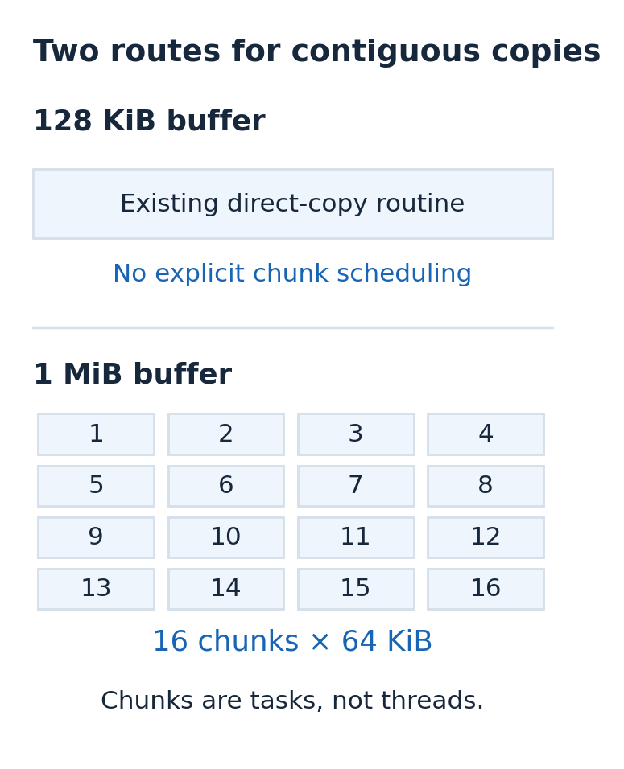
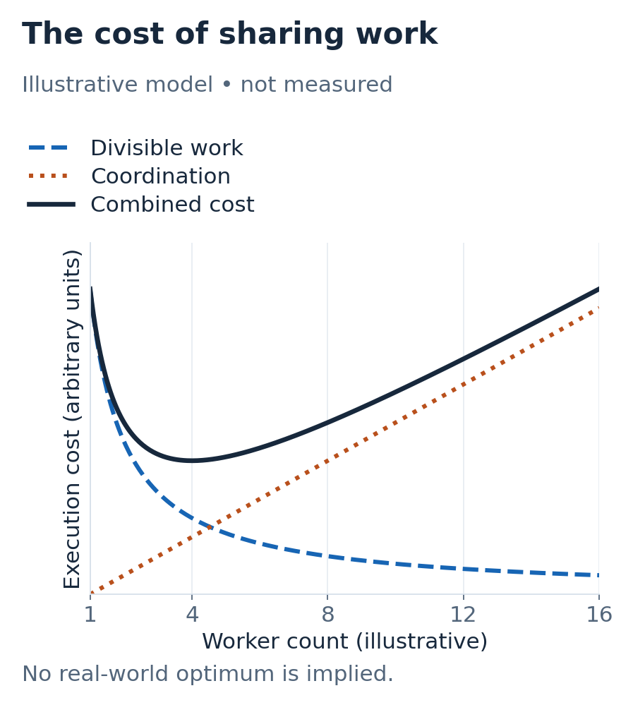
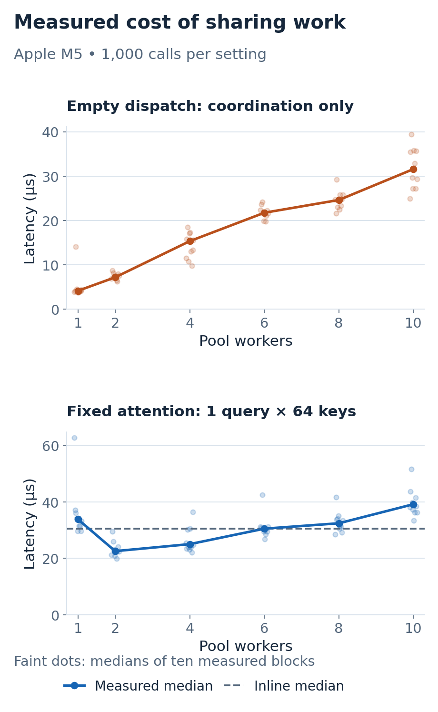
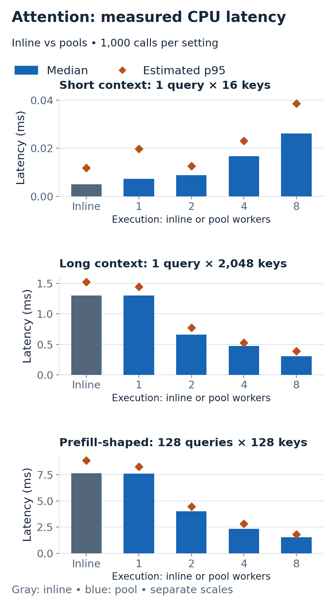
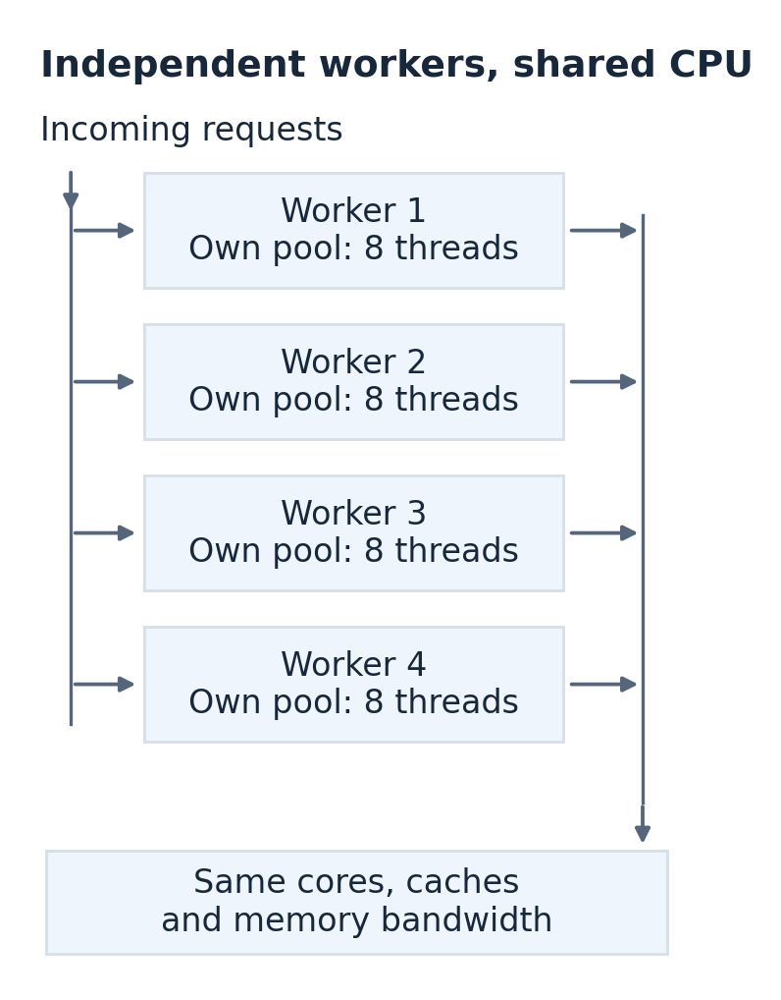

# Why More CPU Threads Can Make Inference Slower

*More workers can help. Giving them enough useful work is the harder part.*

If a model is running on the CPU, turning up the thread count feels like a sensible first step. There are more cores available. Why not use them?

Sometimes that helps. But sharing work creates work of its own: dividing an operation into tasks, handing them out and coordinating when they finish. A large computation may easily recover that cost. A small tensor copy may finish sooner without the extra scheduling.

A model contains both kinds of operations. A setting that helps a large attention operation can add overhead elsewhere in the same request. Put the model behind an API, and concurrent requests change the trade-off again.

So before adding workers, I’d ask a different question: **what will each worker actually do?**

## Start with the size of the work

An existing thread pool avoids creating operating-system threads for every operation. It still has to dispatch work and coordinate completion.

Data movement adds another constraint. Workers share the memory system, and adding threads doesn’t increase memory bandwidth indefinitely. Once that becomes the limit, extra workers may offer little benefit or introduce more contention.

These trade-offs show up in a tensor-copy change I wrote. Two paths in that change are worth separating. They solve related problems, but they don’t use the same cutoff. [Implementation reference][implementation]

### Concatenation: expose more than one task per input

The old concatenation path indexed its parallel range by input tensor. It also asked the scheduler for a single work unit when total input size was **at or below 1,000,000 bytes**, keeping that work serial. Above that threshold, only a few inputs could still expose too few work items.

The revised path divides each input slice into chunks of up to **64 KiB** and enters its explicit parallel branch above **64 KiB**. That lowers the gate: sizes between 64 KiB and 1,000,000 bytes become eligible for parallel scheduling.

The aim was to expose finer work units and make parallelism available sooner. Whether that pays off depends on the shape and scheduler costs. The code alone cannot establish that the lower gate is optimal.

Chunks stop at slice boundaries. Concatenating along an inner axis can therefore produce many pieces of only a few hundred bytes. A 64 KiB upper bound does not guarantee substantial work per task.

The same patch changes split and transpose scheduling differently. Those paths need separate analysis; this example focuses on concatenation and contiguous copying.

### Contiguous copying: keep a direct route for small buffers

A separate reshape-related path copies between distinct, contiguous buffers. Here, buffers **at or below 128 KiB** keep the existing direct-copy routine. Buffers **above 128 KiB** enter an explicit parallel path, again using chunks of up to **64 KiB**.



*Figure 1. Code-derived chunk size and cutoff, illustrated with two buffer sizes.*

For a **1 MiB** buffer, the arithmetic is straightforward: `1,024 KiB ÷ 64 KiB = 16 chunks`.

Sixteen chunks don’t mean sixteen threads. A smaller worker pool can process several chunks per worker. And “direct copy” means this path skips explicit chunk scheduling; it doesn’t establish the threading behavior of every underlying routine.

I’d measure a new operation before choosing its chunk size or cutoff.

### What the copy path looks like

Here is a **standalone C++20 example of the same idea**, using the standard library. It creates fresh threads on every call, so thread creation can overwhelm a small copy. The inherited 128 KiB cutoff illustrates the branch and has not been tuned for this version. Use this to understand the partitioning; a performance-oriented implementation would normally reuse workers.

`std::jthread` joins its thread on destruction. The reference points to the C++20-era draft. [C++ reference][cppthreads]

```cpp
#include <algorithm>
#include <cstddef>
#include <cstring>
#include <thread>
#include <vector>

// Valid, non-overlapping contiguous buffers; no concurrent external writes.
inline void copy_chunked(std::byte* dst, const std::byte* src,
                         std::size_t bytes, std::size_t workers) {
    constexpr std::size_t chunk = 64 * 1024;
    if (bytes == 0) return;
    if (bytes <= 2 * chunk || workers <= 1) {
        std::memcpy(dst, src, bytes);
        return;
    }
    const std::size_t tasks = bytes / chunk + (bytes % chunk != 0);
    workers = std::min(workers, tasks);
    std::vector<std::jthread> threads;
    threads.reserve(workers);
    for (std::size_t w = 0; w < workers; ++w) {
        threads.emplace_back([=] {
            for (std::size_t i = w; i < tasks; i += workers) {
                const std::size_t offset = i * chunk;
                std::memcpy(dst + offset, src + offset,
                            std::min(chunk, bytes - offset));
            }
        });
    }
    // jthread destructors join before this function returns.
}
```

The attention benchmark below uses a persistent pool, with thread creation outside its timer.

The last chunk can be smaller than 64 KiB. Each task writes a distinct destination interval, so tasks don’t need a lock around the copy. That depends on the preconditions: overlapping buffers, concurrent access from elsewhere, or strided storage require different handling. The `jthread` objects join before the function returns, so downstream operations can read the completed output.

There’s a boundary worth noticing. **128 KiB** takes the direct route. **128 KiB + 1 byte** exposes three chunks, with just one byte in the last chunk. The branch condition can admit very small tail tasks; the eligible size alone says little about the benefit.

In this implementation, worker `w` handles chunk indices `w, w + workers, ...`. Four workers can therefore copy sixteen chunks without creating sixteen threads. A production scheduler may group or distribute chunks differently.

### What the reported patch measurements show

The public report labels its CPU “Ryzen x2700” and mentions default CMake options, without specifying a thread count. It contains 106 rows, including 37 CPU rows. The table shows the two largest percentage reductions in CPU latency, YOLOv5 and YOLOv8, and the largest percentage increase, AlexNet. The [complete CPU table](data/reported-patch-cpu-results.csv) is available alongside these reported geometric-mean latencies:

| Model | Baseline | Combined patch |
| --- | ---: | ---: |
| AlexNet | 11.633 ms | 11.967 ms |
| YOLOv5 | 37.554 ms | 31.078 ms |
| YOLOv8 | 50.080 ms | 45.075 ms |

Across all 37 CPU rows, reported latency fell in **25** and rose in **12**. **24** changed by less than 2%, while **seven** reduced latency by at least 5%. AlexNet’s latency increased about **2.9%**. The unweighted geometric mean of the baseline-to-patch speed ratios is approximately **1.02×**, or about 2% faster.

These reported results include improvements and a regression. They measure the combined layer changes, so they cannot isolate chunking or establish the best thread count. The attention experiment below asks a separate question: what happens when pool width changes for a fixed kernel? [Published patch results][patch-results]

## When coordination costs more than it saves

A useful way to reason about parallel execution is to separate the work being shared from the cost of sharing it.

A rough bookkeeping model is:

```text
T(P) ≈ T_serial + T_divisible / P + H(P) + M(P)
```

Here, `P` is the number of workers actually participating. `T_serial` is work that stays serial, `H(P)` represents dispatch and coordination, and `M(P)` represents additional memory-system or contention costs. The `1/P` term assumes ideal load balance. These terms help reason about the trade-off; a runtime trace would be needed to estimate them.

Even in this simplified model, using more workers only helps if the useful time saved exceeds the added costs. Going from `P` to `Q` workers, with `Q > P`, requires:

```text
T_divisible × (1/P − 1/Q)
    > [H(Q) − H(P)] + [M(Q) − M(P)]
```

That’s the trade-off I’d want a benchmark to test.

The following graph sketches that idea with a deliberately simple cost model. As workers increase, divisible work gets cheaper while coordination gets more expensive. Their sum can eventually rise.



*Figure 2. Conceptual cost model with arbitrary assumptions. Its turning point has no hardware significance.*

Real runtimes are messier. Work may be uneven, only part of an operation may be parallel, and memory bandwidth can limit scaling. Coordination cost also needn’t grow smoothly with the worker count. The [figure and source notes][methodology] spell out the assumptions.

The graph explains how a slowdown can happen. Establishing whether it happened in a particular model, and understanding why, takes measurements and profiling.

## A concrete example: scaled dot-product attention

Let’s apply the same question to attention. For each batch item and head, the operation is:

```text
Q: [Lq, Dk]    K: [Lk, Dk]    V: [Lk, Dv]
O = softmax(Q × transpose(K) / sqrt(Dk)) × V
```

Softmax runs across the keys for each query row. [Attention reference][attention]

For a readable CPU reference, each task can own a tile of query rows within one head. That keeps its output writes separate from other tasks. Here is the **attention pseudocode**, with batch size one and no mask or dropout:

```text
tasks = [(head, query_tile) for each head and query tile]
start W persistent C++ worker threads before timing

for each dispatched task (head, query_tile):
    for query_row in query_tile:
        for key_row in 0 .. Lk-1:
            score[key_row] = dot(Q[head, query_row],
                                 K[head, key_row]) / sqrt(Dk)

        # Stable softmax over the complete key dimension.
        weight = exp(score - max(score))
        weight = weight / sum(weight)
        O[head, query_row] = sum_over_keys(
            weight[key_row] * V[head, key_row])

wait until every task has finished before returning O
```

Each worker needs its own score buffer. Query rows are independent here, but the keys within a row participate in a shared softmax reduction. Normalizing each key tile separately and then adding the outputs would be incorrect. Key tiling can work with online softmax, which combines partial results using their normalization statistics, as in FlashAttention. [Online-softmax reference][online] A causal or padding mask must be applied before softmax; this example deliberately uses unmasked inputs with at least one key.

The [complete C++ example](examples/attention_benchmark.cpp) implements both the attention calculation and a fixed-size pool with standard-library threads, condition variables and an atomic task index. The caller waits; it does not compute an extra share of the work. No BLAS library adds hidden worker pools.

## What sharing work costs on this device

To put measured data next to the conceptual model, I ran a dedicated probe on an Apple M5. It uses the C++ pool and attention kernel described above, with pool widths of **1, 2, 4, 6, 8 and 10**.

The first measurement dispatches **zero attention tasks**. This pool still notifies its workers, checks the task index and waits for every worker to acknowledge completion. Timing that path measures coordination without attention arithmetic. Thread creation stays outside the timer.

The second measurement runs a fixed attention job: **batch 1, eight heads, one query per head, 64 keys and head dimension 64**. It exposes eight tasks. An inline run executes the same attention kernel on the caller.

**Comparison caveat.** Inline work runs on a caller at `USER_INTERACTIVE` QoS, while pool workers use `DEFAULT`. This difference can affect performance-versus-efficiency core placement and execution time. Inline-to-pool comparisons therefore include a QoS asymmetry as well as dispatch costs. Comparisons between pool widths retain the same requested worker class.



*Figure 3. Measured companion to Figure 2, from 27,000 observations in a dedicated run. Each configuration has 1,000 samples across ten shuffled rounds, after at least 250 ms of warm-up per block. Lines show pooled medians; dots show block medians. Pools are recreated per block, so block shifts can dominate pooled tail statistics in the report. The lower panel includes the inline median.*

The empty-dispatch median rose from **4.0 μs** at one worker to **25.9 μs** at ten. The fixed attention job took **25.1 μs inline**. Its pool median fell from **29.4 μs** at one worker to **21.5 μs** at two, then reached **33.5 μs** at ten.

The useful comparison is with inline execution: **at every tested width from six workers upward, the pool median exceeded the inline median**. Two workers had the lowest pooled median among the tested widths for this shape and run.

The panels measure separate operations. Empty dispatch is a control for this pool’s notification and completion path, not a component we can subtract from attention latency to recover “pure compute.” Real work changes worker participation, cache state and scheduling. Runtimes that skip empty dispatch or wake fewer workers will behave differently.

The probe also tested 16-key and 2,048-key attention and retained every configuration. All attention outputs matched inline execution and an independent NumPy calculation. The expanded worker range passed separate AddressSanitizer and ThreadSanitizer checks before timing. The checks cover the exercised cases; sanitizer runs are separate from timing. [Probe source](examples/sharing_benchmark.cpp) · [Raw samples](data/sharing-samples.csv) · [Report](data/sharing-report.json) · [Method and validation notes][methodology]

## Attention across three workloads

The measured host was an **Apple M5 with four performance cores and six efficiency cores**, 16 GB of memory, and macOS 26.6.2. The benchmark compares execution inline on the caller with persistent pools of **1, 2, 4 and 8 workers**. The caller waits in pool mode, so the one-worker pool still pays for dispatch and completion. The caller/worker QoS difference described above also applies to this sweep; core placement was not measured.

Every case uses **batch 1, eight heads, `Dk = Dv = 64`**, and FP32 input/output storage with double-precision accumulation. Query tiles contain up to 32 rows: the two single-query cases expose eight tasks, while the prefill-shaped case exposes thirty-two.

Each configuration received **at least 250 ms of warm-up and at least twenty calls before every measured block**. Ten shuffled rounds of 100 measurements produced **1,000 samples per configuration**, or **15,000 samples overall**. Inline samples time the same kernel directly; pool samples include dispatch, computation and completion, with thread creation outside the timer.

| Workload (queries × keys per head) | Inline (μs) | Pool: 1 worker (μs) | Pool: 8 workers (μs) |
| --- | ---: | ---: | ---: |
| Short context: 1 × 16 | 5.4 | 7.9 | 25.6 |
| Long context: 1 × 2,048 | 1,356.3 | 1,313.3 | 337.7 |
| Prefill-shaped: 128 × 128 | 7,336.9 | 7,667.1 | 1,659.6 |



*Figure 4. Measured reference-attention latency, 1,000 calls per configuration across ten shuffled rounds. Gray bars show inline execution; blue bars show pools. Diamonds show pooled p95; faint dots show block medians. Pools are recreated per block, so a whole slow block can dominate pooled p95. Each panel has its own scale.*

The short-context measurement favors inline execution. Eight workers have a higher median even though the larger attention workloads benefit, with observed **3.9× and 4.6×** speedups over the one-worker pool for long context and prefill-shaped attention.

Repeated measurements also put the ratios in perspective. Across two earlier runs using a fixed twenty-call warm-up and two reruns using at least 250 ms per block, all measuring the same short-context shape, eight workers took about **4.5 to 5.3 times** the inline median. Absolute timings moved too. The qualitative result repeated, while run-to-run variation limits the precision of any single factor. The [earlier fixed-call reports](data/initial-summaries.json) and [original source/data package](data/initial-publication.zip) are retained.

The time-warmed pair agreed more closely on the **ten configurations shared by both experiments**: its largest median difference was about **7%**, compared with about **30%** for the earlier fixed-call pair, using the first sweep’s median as the denominator. That is better agreement in these runs; other conditions may also have changed.

**How far to take these results.** This is a scalar reference kernel on a shared desktop, with reused buffers and default OS scheduling and power management. Worker placement on performance versus efficiency cores was not recorded, and dynamic task assignment does not guarantee each worker receives a task. A time-based warm-up reduces startup exposure but cannot guarantee a stationary CPU state. Pooled p95 combines variation within calls and shifts between blocks; identifying causes needs profiling. The unmasked prefill-shaped case represents the attention operation only. Model projections, the rest of a Transformer and serving queueing are outside the measurement. Tail percentiles describe this run and still need replication under deployment conditions.

Outputs matched across inline execution and every worker configuration, and passed an independent NumPy attention calculation at `rtol=1e-5, atol=1e-6`. The package includes [raw samples](data/attention-samples.csv), the [report](data/attention-report.json), [environment details](data/attention-environment.txt) and [reproduction instructions][methodology].

## A copy can run out of bandwidth before it runs out of cores

A convolution performs arithmetic as well as moving data. A plain copy does very little arithmetic per byte, so its scaling can hit a memory-system limit sooner.

For a copy of `N` bytes completed in `t` seconds, a useful reporting convention is:

```text
effective copy bandwidth = (N bytes read + N bytes written) / t
                         = 2N / t
```

This **effective bandwidth metric** counts the requested reads and writes. Physical DRAM traffic can differ. Cache residency, write allocation and the copy implementation can change the actual traffic. The STREAM benchmark uses a similar read-plus-write accounting convention for its Copy kernel. [Bandwidth reference][bandwidth]

That distinction matters when benchmarking repeatedly. Reusing the same buffers may mostly exercise caches; rotating through a larger working set can exercise a different part of the memory hierarchy. Neither experiment automatically represents a full inference request.

If copy throughput plateaus as workers increase, bandwidth saturation is one possibility. I’d check bandwidth counters and scheduling traces before naming the cause. CPU utilization alone can’t distinguish useful progress from waiting or contention.

## Now put the model behind an API

A single-request benchmark leaves out something a service has to handle: other requests.

Suppose four independent serving workers each own a runtime pool configured for eight threads. They all share the machine’s CPU and memory resources.



*Figure 5. Illustrative topology with one pool per serving worker. Shared-pool designs behave differently, and actual simultaneous execution depends on available work and CPU resources.*

It helps to name the layers:

- **Intra-operator parallelism:** workers cooperate on one operation, such as a convolution or copy.
- **Inter-operator parallelism:** independent nodes in the graph execute concurrently.
- **Request concurrency:** the application runs multiple inferences at once.

With independent pools, `serving workers × configured pool size` is a rough way to count configured pool capacity. Actual runnable-thread counts depend on which pools have work. Shared pools, caller participation and nested math-library pools can change the picture. When runnable work exceeds the CPU capacity available to the process, scheduling and contention become part of request latency.

Pool waiting behavior matters too. Some runtimes let idle workers spin briefly, polling for work instead of immediately sleeping. Spinning can reduce wakeup latency, but consumes CPU cycles and power while workers wait. The measured example uses condition-variable waits. A busy-looking CPU therefore doesn’t necessarily mean the model is making useful progress.

The linked ONNX Runtime pages provide general threading and profiling examples. Their settings belong to a separate runtime from the source patch and the measured C++ pool. Spinning versus sleeping is one more choice to test under a service’s actual load. [Thread-management reference][threading]

A larger pool might help one isolated request while leaving less capacity for concurrent traffic. That’s why I’d measure isolated latency, throughput under load and tail latency separately.

## What I’d check before trusting a result

1. **Decide what matters.** Is it one request’s latency, throughput, or p95 latency at a defined request rate?
2. **Record the workload.** Keep the model revision, input shape, batch size, precision, backend and build fixed.
3. **Verify the thread control.** Check how the selected runtime implements the setting. For example, the tensor-copy runtime’s GCD backend documents support only for nonpositive thread settings; requesting four does not establish a four-worker cap. This is a limitation of that runtime interface, not of Apple’s GCD API. [Backend implementation][backend] · [API documentation][thread-control]
4. **Keep the timer consistent.** State whether it includes input assignment, preprocessing or execution alone. Warm up each configuration and vary the test order.
5. **Keep the raw samples.** Repeat runs and compare the median and upper percentiles. A faster median can hide a worse tail; one noisy run can also mislead.
6. **Test realistic traffic and check outputs.** Account for application workers and runtime pools together, and verify numerical correctness in every configuration.

### A small timing helper

I’d keep the timing code boring. This Python helper measures one synchronous call at a time and retains every sample:

```python
from time import perf_counter_ns
import numpy as np


def measure(run_once, *, warmup=50, repeats=1000):
    if warmup < 0 or repeats < 1:
        raise ValueError("warmup >= 0 and repeats >= 1 required")

    for _ in range(warmup):
        run_once()

    samples_ms = []
    for _ in range(repeats):
        start = perf_counter_ns()
        run_once()  # Must return only after the measured work finishes.
        samples_ms.append((perf_counter_ns() - start) / 1e6)

    return {
        "median_ms": float(np.median(samples_ms)),
        "p95_ms": float(np.percentile(samples_ms, 95)),
        "samples_ms": samples_ms,
    }
```

`run_once` should use preloaded inputs and include exactly the work you intend to time. Configure the runtime before calling `measure`; don’t change thread settings inside the timed region. If execution is asynchronous, the wrapper needs an explicit completion wait. Check output correctness separately.

The warm-up and sample counts above are starting points, not statistical guarantees. For very short operations, Python call overhead and the timer itself can matter. Repeat the experiment, vary configuration order and inspect the raw distributions. This helper measures isolated calls; a service benchmark also needs arrival rate, queueing time and end-to-end response latency.

### Profile the part that got slower

Once a difference repeats, I’d narrow the investigation:

| Observation | What I’d inspect next |
| --- | --- |
| Small operators get slower as workers increase | Dispatch, worker wakeups and completion waits in a CPU trace |
| Copy throughput stops improving | Cache behavior, memory bandwidth and effective working-set size |
| One request improves, but loaded p95 worsens | Request queues, runnable threads, independent pools and CPU limits |

Use these observations to choose what to measure next. Operator timings help locate the affected work; OS traces and hardware counters help explain what the CPU was doing. Profiling adds overhead, so I’d confirm the latency difference again with profiling disabled. [Profiling reference][profiling]

If latency gets worse, that’s an observation. Scheduling overhead, memory contention and competing pools are possible explanations. A latency number alone doesn’t tell us which one caused it.

For the copy paths above, the practical question is concrete: does the scheduler have enough useful work to distribute, and is that work large enough to justify sharing it?

That’s where I’d start before reaching for a larger thread count.

[implementation]: https://github.com/opencv/opencv/commit/d95badefa42cc24b6feaba3f4e7cdf469727a6ae
[threading]: https://onnxruntime.ai/docs/performance/tune-performance/threading.html
[backend]: https://github.com/opencv/opencv/blob/d95badefa42cc24b6feaba3f4e7cdf469727a6ae/modules/core/src/parallel.cpp
[methodology]: benchmark-methodology.md

[bandwidth]: https://www.cs.virginia.edu/stream/ref.html
[profiling]: https://onnxruntime.ai/docs/performance/tune-performance/profiling-tools.html

[cppthreads]: https://timsong-cpp.github.io/cppwp/n4861/thread.jthread.class
[attention]: https://arxiv.org/html/1706.03762v7#S3.SS2.SSS1

[online]: https://arxiv.org/html/2205.14135v2#S3.SS1
[patch-results]: https://github.com/opencv/opencv/pull/28821

[thread-control]: https://docs.opencv.org/4.13.0/db/de0/group__core__utils.html
